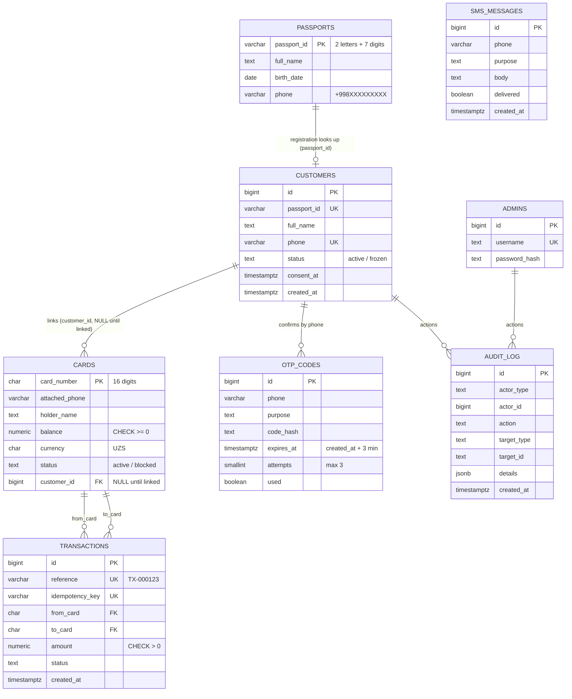

# SmartBank – ER diagram (task T-03)

Rendered automatically by GitHub (Mermaid). The SQL version is in [schema.sql](schema.sql).

Tables in the `mock` schema imitate external systems (Passport Registry, SMS gateway). The `cards` table is the bank's card table; its seeded data plays the role of the mock **Card Registry**.

