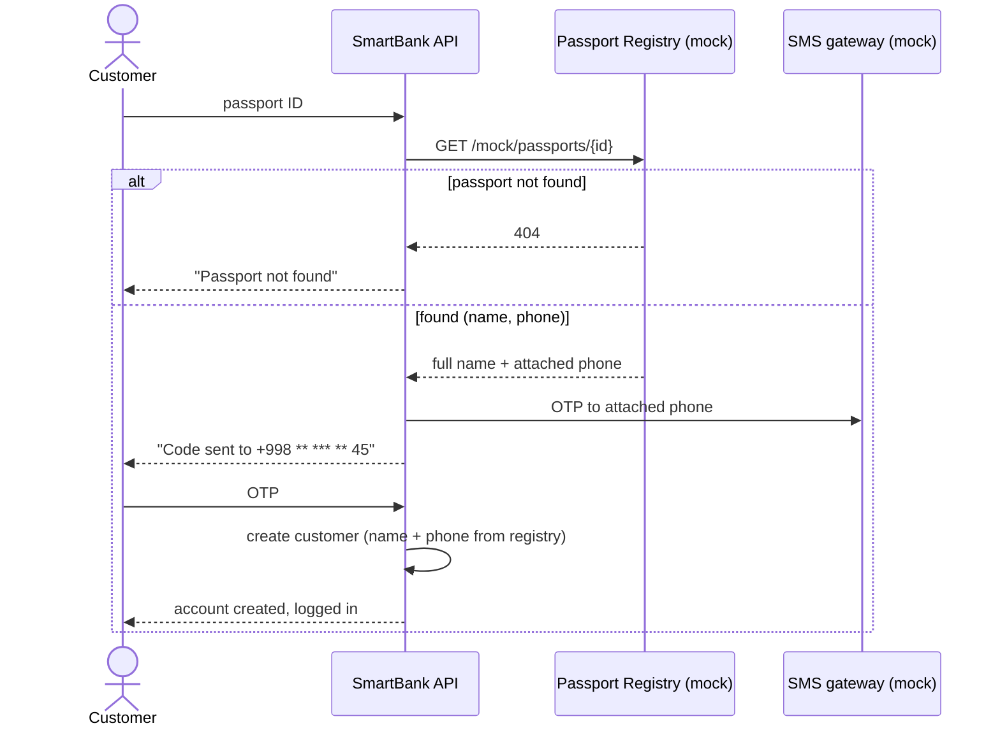
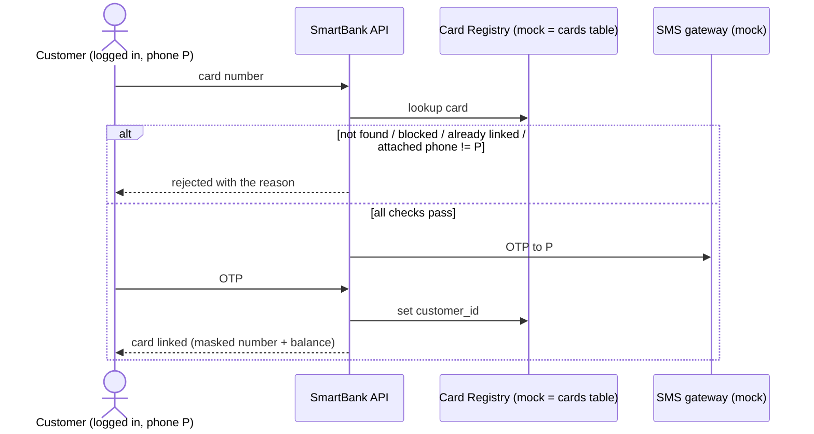

# SmartBank – main flows (sequence diagrams)

Rendered automatically by GitHub (Mermaid). "Mock" = imitated external system.

## 1. Registration by passport ID (US-02, FR-01, FR-02)



## 2. Link a card (US-04, FR-04)



## 3. Card-to-card transfer (US-01, FR-06, FR-07, FR-08)

```mermaid
sequenceDiagram
    actor C as Customer
    participant API as SmartBank API
    participant DB as PostgreSQL
    participant SMS as SMS gateway (mock)
    C->>API: from card, to card, amount
    API->>API: validate (cards active, amount > 0, balance enough)
    API->>SMS: OTP to customer's phone
    C->>API: OTP + idempotency key
    API->>DB: BEGIN; lock both cards; debit; credit; insert transaction; COMMIT
    DB-->>API: transaction TX-000123
    API->>SMS: notification to sender and recipient
    API-->>C: receipt (reference, amount)
```
